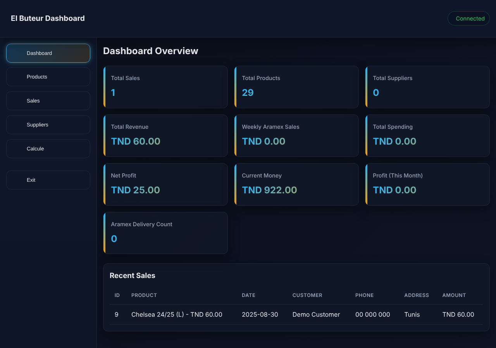

# 📦 App-Stock: Inventory & Sales Dashboard

A stock-management and sales dashboard built for **El Buteur**, a small online shop that sells football boots and jerseys in Tunisia. It tracks products, sales, supplier purchases and delivery activity, and computes the shop's key business KPIs in real time.



## Features

**Dashboard (real-time KPIs)**
- Total sales, products in stock and suppliers
- Total revenue, total spending, **net profit** (sell price − buy price × quantity)
- **Current money** = initial capital + revenue − supplier spending
- **Profit this month** vs previous month
- **Weekly Aramex sales** (Saturday → Friday week, matching the courier's payout cycle) vs previous week
- Aramex delivery counter and the 5 most recent sales

**Management pages**
- **Products:** add / edit / delete; profit per unit is computed by the database
- **Sales:** customer, product, size, quantity, shipping method (Aramex or direct), notes
- **Suppliers:** invoices, product, sizes, buy price, payment method (cash / card / transfer)
- **Monthly calculations:** save a monthly snapshot of all KPIs to build a month-by-month history (re-saving a month updates it)

## Tech stack

| Layer | Technology |
|---|---|
| Front end | Single-page HTML / CSS / vanilla JavaScript (`fetch` API) |
| Back end | PHP 8 REST API (`api.php`), PDO with prepared statements |
| Database | MySQL / MariaDB (`el_buteur.sql`), with generated columns for profit |

## API

One endpoint, `api.php?entity=…`:

| Entity | GET | POST | PUT `&id=` | DELETE `&id=` |
|---|---|---|---|---|
| `dashboard` | KPIs + recent sales | | | |
| `products` | list | create | update | delete |
| `sales` | list | create | update | delete |
| `suppliers` | list | create | update | delete |
| `monthly_kpis` | history | save / update a month | | |

Request and response bodies are JSON. `POST …&_method=PUT|DELETE` is also accepted for hosts that block those verbs.

## Getting started (XAMPP)

1. Install [XAMPP](https://www.apachefriends.org/) and start **Apache** and **MySQL**.
2. Copy the project into `C:\xampp\htdocs\App-Stock`.
3. Open **phpMyAdmin**, create a database named `el_buteur`, and import `el_buteur.sql`.
4. Open <http://localhost/App-Stock/Index.html>.

Database credentials default to XAMPP's (`root`, no password). To change them, set the `DB_HOST`, `DB_NAME`, `DB_USER` and `DB_PASS` environment variables, or edit the top of `api.php`.

Business settings at the top of `api.php`:

```php
const INITIAL_CAPITAL = 862;        // cash before the first transaction was recorded (TND)
const ARAMEX_COUNTER_OFFSET = 4;    // deliveries made before the app was used
```

## Data model

```
products (product_id, category, name, size, supplier, quantity, buy_price, sell_price, profit_per_unit*)
sales    (sale_id, customer…, product_id → products, quantity, buy_price, sell_price, total_profit*, sale_date, shipping_method)
suppliers(id_supp, num_fact, name, product, sizes, buy_price, quantity, payment_method, total_price*)
monthly_kpis (id, month_year, sales_count, delivery_count, … , current_money)
* generated columns
```

## Possible next steps

- Login (the API is currently open; run it only locally or behind authentication)
- Charts of monthly revenue and profit
- Automatic stock decrease when a sale is recorded

## Author

**Youssef**, Business Intelligence student at IHEC Carthage · [GitHub](https://github.com/YusfAI)
